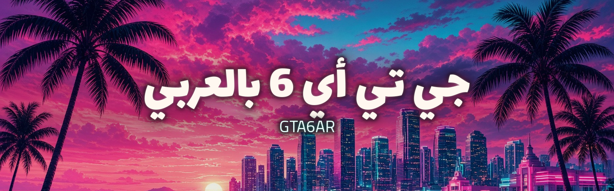

# GTA6AR

## عن اللعبة

**غراند ثيفت أوتو 6** (Grand Theft Auto VI) لعبةٌ من تطوير [Rockstar Games](https://www.rockstargames.com/) ونشر [Take-Two Interactive](https://www.take2games.com/)، ومن المقرر صدورها في 19 نوفمبر 2026.

## أهداف المشروع

- تعريب نصوص اللعبة تعريبًا كاملًا.
- دبلجة صوتية عربية.
- تعريب الصور والرسوم داخل اللعبة.
- إنجاز كل ذلك بالذكاء الاصطناعي بالكامل، دون ترجمة أو أداء صوتي أو رسم بشري.
- مشروع مجتمعي مفتوح المصدر.
- يقتصر التوزيع على الترقيعات والأدوات دون ملفات اللعبة، ويلزم اللاعبَ امتلاكُ نسخة أصلية.

## القيادة

يقود المشروع **(ص) بويوسف**: [x.com/sbalhatlani](https://x.com/sbalhatlani)

## المشاركة

المشاركة متاحة لكل أفراد المجتمع، عبر تشغيل خطوط الإنتاج بالذكاء الاصطناعي، وتطوير الأدوات، والإبلاغ عن الأخطاء. تجد التفاصيل في [CONTRIBUTING.md](CONTRIBUTING.md).

## نماذج الذكاء الاصطناعي المعتمدة

| المجال | الحد الأدنى للنموذج |
|---|---|
| الدبلجة والأداء الصوتي | ElevenLabs v4 أو أقوى |
| الترجمة والنصوص | Gemini 3.8 Flash أو أقوى |
| الصور والرسوم | Sunburn من OpenAI أو أفضل |

## تنويه

هذا مشروع جماهيري غير رسمي، ولا صلة له بشركة Rockstar Games أو Take-Two Interactive، والعلامات التجارية ملكٌ لأصحابها.

التعريب والدبلجة والكتابة والصور في هذا المشروع منتَجة كلها بالذكاء الاصطناعي.

---

## English

**GTA6AR** is a community open-source Arabic localization of *Grand Theft Auto VI* (Rockstar Games / Take-Two Interactive, 19 Nov 2026): full text translation, Arabic voice dubbing, and in-game image localization, all produced entirely by AI with no human translation, voice acting, or art. We distribute patches and tools only — never game files. You need your own legal copy.

Led by **(ص) بويوسف**: [x.com/sbalhatlani](https://x.com/sbalhatlani)

Anyone in the community can contribute by running the AI pipelines, building tools, and reporting bugs. See [CONTRIBUTING.md](CONTRIBUTING.md).

Minimum models: ElevenLabs v4 or stronger for voice, Gemini 3.8 Flash or stronger for translation, and OpenAI Sunburn or better for images.

Unofficial fan project, not affiliated with Rockstar Games or Take-Two Interactive. Trademarks belong to their owners. All localization, dubbing, writing, and images are AI-generated.
