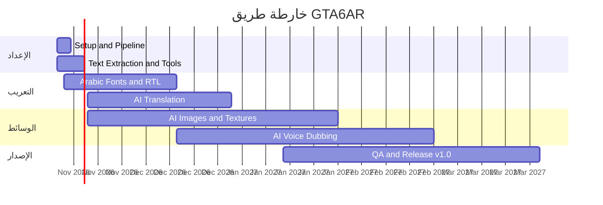

# GTA6AR

## الهدف

أن نوفر تعريبًا عربيًا فصيحًا متكاملًا للعبة **غراند ثيفت أوتو 6**، يشمل النصوص والدبلجة والصور، ويُنجز بالكامل بالذكاء الاصطناعي وفق النماذج المعتمدة، ثم ننشر ترقيعًا وأدواتٍ مجانيةً مفتوحة المصدر تبلغ الإصدار **1.0** بعد صدور اللعبة في **19 نوفمبر 2026**، من غير أن نوزّع أيًّا من ملفات اللعبة الأصلية. يلزم اللاعبَ امتلاكُ نسخة قانونية.

## لوحة التقدم

نتتبع العمل عبر [المعالم السبعة](https://github.com/DiNaSoR/GTA6AR/milestones) و[القضايا](https://github.com/DiNaSoR/GTA6AR/issues)، مصنّفة حسب المجال (ترجمة، دبلجة، صور، خطوط، أدوات، جودة). النسب في مرحلة التخطيط بين 0٪ و10٪، وهذا متوقع قبل صدور اللعبة، وتُحتسب من القضايا المغلقة مقابل المفتوحة.

<!-- progress-table:start -->
  

| المجال | التقدّم | النسبة | الحالة | المَعلم |
|---|---|---|---|---|
| الترجمة / Translation |  `░░░░░░░░░░` | 0% (0/5) | لم يبدأ / Not started | [الترجمة](https://github.com/DiNaSoR/GTA6AR/milestone/3) |
| الدبلجة / Voice |  `░░░░░░░░░░` | 0% (0/4) | لم يبدأ / Not started | [الدبلجة](https://github.com/DiNaSoR/GTA6AR/milestone/5) |
| الصور / Images |  `░░░░░░░░░░` | 0% (0/3) | لم يبدأ / Not started | [الصور](https://github.com/DiNaSoR/GTA6AR/milestone/6) |
| الخطوط وRTL / Fonts & RTL |  `░░░░░░░░░░` | 0% (0/3) | لم يبدأ / Not started | [الخطوط](https://github.com/DiNaSoR/GTA6AR/milestone/4) |
| الأدوات / Tools |  `░░░░░░░░░░` | 0% (0/6) | لم يبدأ / Not started | [الإعداد](https://github.com/DiNaSoR/GTA6AR/milestone/1) · [الأدوات](https://github.com/DiNaSoR/GTA6AR/milestone/2) |
| الجودة والإصدار / QA & Release |  `░░░░░░░░░░` | 0% (0/3) | لم يبدأ / Not started | [الإصدار 1.0](https://github.com/DiNaSoR/GTA6AR/milestone/7) |
| **الكلي / Overall** |  `░░░░░░░░░░` | **0%** (0/24) | لم يبدأ / Not started | [المعالم](https://github.com/DiNaSoR/GTA6AR/milestones) |

تُحتسب النسبة من القضايا المغلقة مقابل المفتوحة في كل تصنيف مجال. يُحدَّث الجدول بتشغيل `.github/scripts/update_progress.py`. [كل القضايا](https://github.com/DiNaSoR/GTA6AR/issues) · [المعالم](https://github.com/DiNaSoR/GTA6AR/milestones)
<!-- progress-table:end -->

### خارطة الطريق

العمل التأسيسي للأدوات والخطوط يبدأ الآن، وأما الترجمة والدبلجة والصور فتتصاعد بعد إصدار اللعبة في 19 نوفمبر 2026، وصولًا إلى الإصدار 1.0.

| المَعلم | الموعد |
|---|---|
| [إعداد خطوط الإنتاج](https://github.com/DiNaSoR/GTA6AR/milestone/1) | 14 نوفمبر 2026 |
| [استخراج النصوص والأدوات](https://github.com/DiNaSoR/GTA6AR/milestone/2) | 18 نوفمبر 2026 |
| [الخطوط العربية ودعم RTL](https://github.com/DiNaSoR/GTA6AR/milestone/4) | 15 ديسمبر 2026 |
| [الترجمة بالذكاء الاصطناعي](https://github.com/DiNaSoR/GTA6AR/milestone/3) | 31 ديسمبر 2026 |
| [الصور والرسوم بالذكاء الاصطناعي](https://github.com/DiNaSoR/GTA6AR/milestone/6) | 31 يناير 2027 |
| [الدبلجة الصوتية بالذكاء الاصطناعي](https://github.com/DiNaSoR/GTA6AR/milestone/5) | 28 فبراير 2027 |
| [المراجعة والإصدار 1.0](https://github.com/DiNaSoR/GTA6AR/milestone/7) | 31 مارس 2027 |

## عن اللعبة

**غراند ثيفت أوتو 6** (Grand Theft Auto VI) لعبةٌ من تطوير [Rockstar Games](https://www.rockstargames.com/) ونشر [Take-Two Interactive](https://www.take2games.com/)، ومن المقرر صدورها في 19 نوفمبر 2026.

## أهداف المشروع

- تعريب نصوص اللعبة تعريبًا كاملًا.
- دبلجة صوتية عربية.
- تعريب الصور والرسوم داخل اللعبة.
- إنجاز كل ذلك بالذكاء الاصطناعي بالكامل، دون ترجمة أو أداء صوتي أو رسم بشري.
- مشروع مجتمعي مفتوح المصدر.
- يقتصر التوزيع على الترقيعات والأدوات دون ملفات اللعبة، ويلزم اللاعبَ امتلاكُ نسخة أصلية.

## القيادة

يقود المشروع **(ص) بويوسف**: [x.com/sbalhatlani](https://x.com/sbalhatlani)

## المشاركة

المشاركة متاحة لكل أفراد المجتمع، عبر تشغيل خطوط الإنتاج بالذكاء الاصطناعي، وتطوير الأدوات، والإبلاغ عن الأخطاء. استخدم [قوالب القضايا](https://github.com/DiNaSoR/GTA6AR/issues/new/choose) واذكر اسم النموذج وإصداره. تجد التفاصيل في [CONTRIBUTING.md](CONTRIBUTING.md).

## نماذج الذكاء الاصطناعي المعتمدة

| المجال | الحد الأدنى للنموذج |
|---|---|
| الدبلجة والأداء الصوتي | ElevenLabs v4 أو أقوى |
| الترجمة والنصوص | Gemini 3.8 Flash أو أقوى |
| الصور والرسوم | Sunburn من OpenAI أو أفضل |

## تنويه

هذا مشروع جماهيري غير رسمي، ولا صلة له بشركة Rockstar Games أو Take-Two Interactive، والعلامات التجارية ملكٌ لأصحابها.

التعريب والدبلجة والكتابة والصور في هذا المشروع منتَجة كلها بالذكاء الاصطناعي.

---

## English

**GTA6AR** is a community open-source Arabic localization of *Grand Theft Auto VI* (Rockstar Games / Take-Two Interactive, 19 Nov 2026): full text translation, Arabic voice dubbing, and in-game image localization, all produced entirely by AI with no human translation, voice acting, or art. We distribute patches and tools only — never game files. You need your own legal copy.

### Goal

Ship a complete, formal-Arabic localization of Grand Theft Auto 6 — text, voice, and images — produced entirely by AI with the approved models, and release a free and open-source **v1.0** patch and toolchain after the **19 November 2026** launch, without ever distributing original game files.

### Progress

Tracking lives in [milestones](https://github.com/DiNaSoR/GTA6AR/milestones) and [issues](https://github.com/DiNaSoR/GTA6AR/issues), grouped by area (translation, voice, images, fonts, tools, QA). The table at the top of this README shows the percentage, status, and milestone for each area. Percentages start at 0–10% during planning, before the game ships, and can be recomputed from closed versus open issues by running `.github/scripts/update_progress.py`.

The mermaid roadmap and milestone dates are in the Arabic «لوحة التقدم» section above.

Led by **(ص) بويوسف**: [x.com/sbalhatlani](https://x.com/sbalhatlani)

Anyone in the community can contribute by running the AI pipelines, building tools, and reporting bugs. Please use the [issue templates](https://github.com/DiNaSoR/GTA6AR/issues/new/choose) and name the model and version. See [CONTRIBUTING.md](CONTRIBUTING.md).

Minimum models: ElevenLabs v4 or stronger for voice, Gemini 3.8 Flash or stronger for translation, and OpenAI Sunburn or better for images.

Unofficial fan project, not affiliated with Rockstar Games or Take-Two Interactive. Trademarks belong to their owners. All localization, dubbing, writing, and images are AI-generated.
